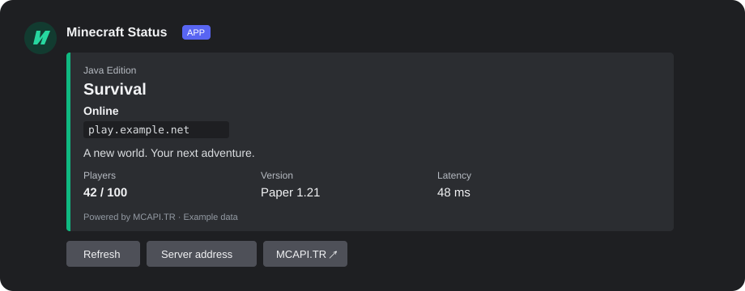

# Minecraft Server Status Discord Bot

Minecraft Java & Bedrock status cards that stay in one Discord message. Built with the official **[mcapitr](https://www.npmjs.com/package/mcapitr)** SDK and discord.js. Self-hosted, open source, no MCAPI API key.

[Türkçe kurulum ve kullanım](README.tr.md) · [MCAPI.TR](https://mcapi.tr) · [API documentation](https://mcapi.tr/api-docs)




_Illustration of the card layout, using example data. The actual card uses Discord's native embed UI and the queried server's icon._

## What it does

- **Java, Bedrock and legacy Java** queries, including custom ports.
- **Persistent status cards**: edit the same message automatically instead of filling a channel with repeated posts.
- **Optional online/offline alerts** after two distinct, fresh observations confirm a change.
- **Honest failure states**: stale observations and API outages are distinct from a confirmed offline result.
- **Player counts, version, MOTD, latency, server icon and observation timestamp.** Latency is measured from MCAPI's infrastructure, not from each Discord member.
- **Refresh and server-address buttons**, permission checks and user cooldowns.
- **English and Turkish** commands, responses and persistent cards.
- **Multiple servers and Discord communities**, with durable local storage, configurable limits and a single-process lock.
- **Docker support**, minimal Discord intents and no administrator permission requirement.

This bot monitors public server status. It does not host AFK accounts, join Minecraft servers, run RCON commands, provide skin/UUID services or store Minecraft login details.

## Quick start

You need **Node.js 22.17+** and a Discord application with a bot user.

```sh
git clone https://github.com/Nexuby/minecraft-server-status-discord-bot.git
cd minecraft-server-status-discord-bot
npm ci
```

Copy `.env.example` to `.env`:

```sh
# Linux / macOS
cp .env.example .env
```

```powershell
# Windows PowerShell
Copy-Item .env.example .env
```

Set `DISCORD_TOKEN` in `.env`. Never put a real token in source code or a GitHub issue. `.env`, its variants and runtime data are ignored by Git; only `.env.example` is tracked.

1. In the [Discord Developer Portal](https://discord.com/developers/applications), create an application and open **Bot** to obtain its token. Keep all privileged intents **off**.
2. Under **Installation**, choose **Guild Install** with the `bot` and `applications.commands` scopes.
3. Grant **View Channels**, **Send Messages**, **Embed Links**, **Attach Files** and **Read Message History**. Administrator, Manage Messages and Message Content intent are unnecessary.
4. Install the application in your Discord server.
5. For development, set `DISCORD_GUILD_ID` to that server's ID. Leave it empty for global commands.

```sh
npm run deploy
npm run build
npm start
```

`deploy` registers/upserts this project's four commands. It preserves other application commands and does not register commands again on every restart. Guild commands appear quickly; global commands may take time to propagate. Avoid registering both scopes in the same test server unless you expect duplicate command entries.

`DISCORD_CLIENT_ID` is optional and detected from the authenticated application. If supplied, it must match the token.

## Commands

| Command                                                    | Purpose                                             | Who can use it |
| ---------------------------------------------------------- | --------------------------------------------------- | -------------- |
| `/status address:mc.hypixel.net`                           | One-off status check; private by default            | Everyone       |
| `/status address:play.cubecraft.net:19132 edition:Bedrock` | Query Bedrock                                       | Everyone       |
| `/status address:mc.hypixel.net public:true`               | Share a one-off result with the channel             | Everyone       |
| `/monitor add address:play.example.net channel:#status`    | Create a persistent status card                     | Manage Server  |
| `/monitor add … alerts:true language:Türkçe name:Survival` | Enable alerts and customize the card                | Manage Server  |
| `/monitor list`                                            | Paginated list with IDs and current channel         | Manage Server  |
| `/monitor pause id:…`                                      | Stop checks and alerts                              | Manage Server  |
| `/monitor resume id:…`                                     | Resume checks and immediately refresh               | Manage Server  |
| `/monitor remove id:…`                                     | Delete the saved monitor and try to delete its card | Manage Server  |
| `/help`                                                    | Command help                                        | Everyone       |
| `/about`                                                   | Refresh interval, data use and project information  | Everyone       |

Discord displays translated command names when your Discord language is Turkish. In that case use `/durum`, `/takip`, `/yardim` and `/hakkinda`. Monitor IDs support autocomplete. A normal member can refresh a card but cannot create, remove or reconfigure a monitor. The refresh button has a shared 30-second cooldown per card; each user also has a 3-second interaction cooldown.

### Status accuracy

The default polling interval is **120 seconds**, plus the time needed to process that cycle. Queries go through `mcapitr.serverStatus()`. There is no independent Minecraft-ping implementation or fallback provider in this project.

Identical concurrent queries are combined. Results are cached locally for 30 seconds and at most three distinct SDK requests run concurrently. HTTP 429 starts a 60-second global cooldown; SDK 2.1 does not expose the upstream `Retry-After` header. Failed requests are cached for 10 seconds.

MCAPI also caches results, so clicking Refresh **does not force a new Minecraft ping**. Cards show the API observation time. Cached/stale data gets an amber warning. An API/network failure displays “Status temporarily unavailable”, never a fabricated offline result.

The first valid observation establishes a baseline without an alert. Changes need **two distinct `checked_at` timestamps** from fresh observations. Repeated cached responses, stale data, missing timestamps and API errors cannot confirm a change. Alerts may therefore arrive later than the polling interval. Alert delivery is best-effort: a failed notification is logged but is not retried, avoiding duplicate posts after a restart. This is not an uptime SLA or an exhaustive outage history.

## Configuration

| Variable                 | Default                   | Meaning                                                |
| ------------------------ | ------------------------- | ------------------------------------------------------ |
| `DISCORD_TOKEN`          | required                  | Your Discord bot token                                 |
| `DISCORD_CLIENT_ID`      | auto-detected             | Optional application identity check during deployment  |
| `DISCORD_GUILD_ID`       | empty                     | Optional development-guild command scope               |
| `DEFAULT_LANGUAGE`       | `en`                      | `en` or `tr`; fallback for unsupported Discord locales |
| `MCAPI_BASE_URL`         | `https://mcapi.tr/api/v1` | API origin; remote URLs require HTTPS                  |
| `POLL_INTERVAL_SECONDS`  | `120`                     | 60–3600 seconds                                        |
| `MAX_MONITORS_PER_GUILD` | `5`                       | 1–25                                                   |
| `MAX_MONITORS_TOTAL`     | `50`                      | 1–100 across this process                              |
| `DATA_DIR`               | `./data`                  | Persistent local storage directory                     |

Defaults suit a small self-hosted installation. MCAPI's public service limits still apply. Large deployments need a deliberate request budget; increasing the monitor limits does not raise MCAPI quotas.

## Docker

Configure `.env` first. Register commands on the host using `npm run deploy`, then:

```sh
docker compose up -d --build
docker compose logs -f bot
```

The image runs as a non-root user. The named `bot-data` volume preserves monitor configuration. No inbound port is needed. A local health file checks gateway readiness; Docker reports health separately from restart policy, and an unhealthy container is not automatically restarted solely by that health check.

Do not run host and Docker instances with the same token at the same time. The process lock protects a shared `DATA_DIR`, not two separate volumes or machines.

## Data, permissions and recovery

`data/monitors.json` stores guild/channel/message IDs, server addresses, display labels, card language and alert state. `data/health.json` stores only readiness and a timestamp. The bot does not read message content, store conversations or require Discord's privileged intents. See [privacy details](docs/PRIVACY.md).

Back up the data directory with the bot stopped. Writes use a temporary file, fsync and atomic replacement. Corrupt data stops startup instead of silently discarding your configuration. Restore a known-good backup if necessary.

If a status card/channel is deleted or required permissions disappear, the monitor pauses rather than reposting unexpectedly. Restore permissions and use `/monitor resume`. A deleted card needs `/monitor remove` followed by `/monitor add`. Removing a monitor drops its saved configuration even when the old Discord message can no longer be deleted.

Run a **single bot process** per data directory. The JSON store is intentionally for a small self-hosted bot; it is not a distributed database. If the process crashes during initial message creation, an incomplete reservation is removed at next startup; a message sent immediately before that crash may need manual cleanup.

## Development and tests

```sh
npm run dev
npm run verify
npm run test:coverage
npm run format:check
npm run secrets:check
```

Unit/integration tests use controlled SDK and Discord transport fixtures; they do not need credentials or post to Discord. `npm run smoke` is an **opt-in live test** using your `.env`: it queries one Java and one Bedrock server, authenticates with Discord, opens a gateway connection and disconnects. It does not send messages or register commands. Do not use it alongside another running instance of the same bot.

CI checks Node.js 22/24, types, tests, formatting, production dependency audit and the Docker build. See [testing and evidence](docs/TESTING.md), [contributing](CONTRIBUTING.md) and [security reporting](SECURITY.md).

For an explicitly authorized test channel, `npm run smoke:channel` provides a separate opt-in prepare/verify/cleanup workflow that posts two real cards. See [real channel testing](docs/TESTING.md#opt-in-real-channel-test) before using it; it needs explicit guild/channel IDs and an isolated data directory.

## License

[MIT](LICENSE) · Nexuby Software Services. Source-code licensing does not replace [MCAPI.TR service terms](https://mcapi.tr/terms) or Discord's terms. Minecraft is a trademark of Mojang/Microsoft; this project is not affiliated with or endorsed by them.
