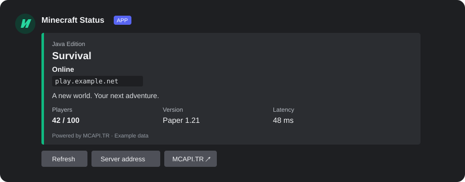

# Minecraft Sunucu Durumu Discord Botu

Minecraft sunucunun durumunu Discord kanalında tek bir mesajda takip et. **Java, Bedrock ve legacy Java** desteği; oyuncu sayısı, MOTD, sürüm, gecikme ve otomatik güncellenen durum kartları.

Bot, tüm Minecraft sorgularını resmî **[mcapitr](https://www.npmjs.com/package/mcapitr)** modülü üzerinden yapar. MCAPI anahtarı gerekmez. [English documentation](README.md) · [MCAPI.TR](https://mcapi.tr)



_Görsel, örnek verilerle hazırlanmış bir tasarım gösterimidir. Gerçek kart Discord'un yerleşik embed görünümünü ve sorgulanan sunucunun ikonunu kullanır._

## Neler var?

- Aynı mesajı otomatik güncelleyen durum kartları; her kontrolde yeni mesaj göndermez.
- Birden fazla sunucu, özel portlar ve birden fazla Discord sunucusu desteği.
- Sunucuyu Yönet yetkisiyle takip oluşturma, listeleme, duraklatma, devam ettirme ve kaldırma.
- İsteğe bağlı açılma/kapanma bildirimi. Tek kontrol yetmez: iki farklı güncel gözlem gerekir.
- Eski veri, API hatası ve gerçekten çevrimdışı sunucu için farklı gösterimler.
- Türkçe/İngilizce komutlar, yanıtlar ve kartlar.
- Yenileme ve sunucu adresi düğmeleri; kullanıcı ve kart bazında bekleme süreleri.
- Yeniden başlatmada korunan ayarlar, atomik dosya yazımı ve aynı veri klasöründe ikinci süreç koruması.
- Docker, testler ve GitHub Actions.

AFK hesap, Minecraft'a giriş, RCON, UUID veya skin servisi içermez. Bot hesabının Discord tokeni dışında Minecraft kullanıcı adı/parolası istemez.

## Kurulum

**Node.js 22.17 veya üzeri** gerekir.

```sh
git clone https://github.com/Nexuby/minecraft-server-status-discord-bot.git
cd minecraft-server-status-discord-bot
npm ci
```

Windows PowerShell:

```powershell
Copy-Item .env.example .env
```

Linux/macOS:

```sh
cp .env.example .env
```

`.env` içindeki `DISCORD_TOKEN` alanına kendi bot tokenini yaz. Gerçek tokeni README'ye, issue'ya veya koda koyma. `.env` ve çalışma verileri Git dışında tutulur.

1. [Discord Developer Portal](https://discord.com/developers/applications) üzerinden uygulama ve bot oluştur. Ayrıcalıklı intent'leri kapalı bırak.
2. **Installation → Guild Install** bölümünden `bot` ve `applications.commands` scope'larını seç.
3. **Kanalı Görüntüle, Mesaj Gönder, Bağlantı Yerleştir, Dosya Ekle, Mesaj Geçmişini Oku** izinlerini ver. Yönetici, Mesajları Yönet veya Mesaj İçeriği intent'i gerekmez.
4. Botu kendi Discord sunucuna ekle.
5. Geliştirme için `.env` içindeki `DISCORD_GUILD_ID` alanına test sunucunun kimliğini ekle. Global komutlar için boş bırak.

```sh
npm run deploy
npm run build
npm start
```

`deploy` yalnızca bu projenin dört komutunu ekler/günceller; uygulamadaki başka komutları topluca silmez. Her açılışta tekrar komut kaydı yapılmaz. Global komutların görünmesi biraz zaman alabilir. Aynı test sunucusunda hem global hem sunucuya özel kayıt oluşturmak çift komut gösterebilir.

## Kullanım

Discord dilin Türkçe olduğunda komutlar Türkçe görünür:

| Komut                                                    | İşlev                                            |
| -------------------------------------------------------- | ------------------------------------------------ |
| `/durum adres:mc.hypixel.net`                            | Özel durum sorgusu; yanıtı yalnızca sen görürsün |
| `/durum adres:play.cubecraft.net:19132 surum:Bedrock`    | Bedrock sorgusu                                  |
| `/durum adres:mc.hypixel.net herkese-acik:true`          | Sonucu kanalla paylaş                            |
| `/takip ekle adres:play.example.net kanal:#durum`        | Otomatik güncellenen kart oluştur                |
| `/takip ekle … bildirim:true dil:Türkçe baslik:Survival` | Bildirimleri ve kart dilini ayarla               |
| `/takip liste`                                           | Takipleri ve kimliklerini sayfalı listele        |
| `/takip duraklat id:…`                                   | Kontrolleri ve bildirimleri durdur               |
| `/takip devam id:…`                                      | Takibi devam ettir                               |
| `/takip kaldir id:…`                                     | Takibi kaldır; mümkünse kartı da sil             |
| `/yardim`                                                | Komutları öğren                                  |
| `/hakkinda`                                              | Yenileme aralığı ve veri kullanımı               |

İngilizce Discord arayüzünde karşılıkları `/status`, `/monitor`, `/help`, `/about` olur. Takip yönetimi için **Sunucuyu Yönet** gerekir. Kimlik seçeneklerinde otomatik tamamlama vardır. Normal üyeler kartı yenileyebilir fakat takip ayarlarını değiştiremez.

## Veriler ne kadar güncel?

Varsayılan kontrol aralığı **120 saniye**; döngünün işlem süresi buna eklenir. Aynı sunucuya eşzamanlı istekler birleştirilir; yerel önbellek 30 saniyedir. MCAPI'nin kendi önbelleği de vardır. **Yenile düğmesi zorla yeni Minecraft ping'i atmaz.** Kartta gösterilen zaman API'nin gözlem zamanıdır.

Eski veri sarı uyarıyla gösterilir. API erişim hatası, sunucu kapalıymış gibi gösterilmez. Ping, MCAPI altyapısından ölçülür; Discord üyesinin kendi bağlantı gecikmesi değildir.

Bildirimler ilk sonuçta gönderilmez. Değişiklik için iki farklı `checked_at` değerine sahip güncel gözlem gerekir. Aynı önbellek yanıtı iki kontrol sayılmaz. Eski veri, eksik zaman bilgisi ve API hatası kesinti bildirimi üretmez. Bu nedenle bildirim, normal kontrol aralığından daha geç gelebilir. Bildirim teslimi garantili değildir; gönderilemeyen bildirim yeniden denenmez.

## Ayarlar

| Değişken                 | Varsayılan                | Açıklama                                        |
| ------------------------ | ------------------------- | ----------------------------------------------- |
| `DISCORD_TOKEN`          | zorunlu                   | Bot tokeni                                      |
| `DISCORD_CLIENT_ID`      | otomatik                  | Komut kaydında isteğe bağlı uygulama kontrolü   |
| `DISCORD_GUILD_ID`       | boş                       | Geliştirme sunucusu; boşsa global komutlar      |
| `DEFAULT_LANGUAGE`       | `en`                      | Desteklenmeyen Discord dilleri için `en` / `tr` |
| `MCAPI_BASE_URL`         | `https://mcapi.tr/api/v1` | API adresi; uzak adreslerde HTTPS zorunlu       |
| `POLL_INTERVAL_SECONDS`  | `120`                     | 60–3600 saniye                                  |
| `MAX_MONITORS_PER_GUILD` | `5`                       | Discord sunucusu başına 1–25 takip              |
| `MAX_MONITORS_TOTAL`     | `50`                      | Süreç genelinde 1–100 takip                     |
| `DATA_DIR`               | `./data`                  | Kalıcı veri klasörü                             |

En fazla üç farklı SDK sorgusu eşzamanlı çalışır. API 429 döndürürse bir dakika genel bekleme uygulanır. `mcapitr` 2.1 `Retry-After` başlığını dışa aktarmadığı için bu süre sabittir. Takip sınırını artırmak MCAPI'nin servis limitlerini artırmaz.

## Docker ve veri saklama

`.env` dosyasını doldurup komutları `npm run deploy` ile kaydettikten sonra:

```sh
docker compose up -d --build
docker compose logs -f bot
```

Konteyner root kullanıcısı olmadan çalışır; `bot-data` volume'u takipleri saklar. Dışarıya port açmak gerekmez. Aynı tokeni kullanan host ve Docker süreçlerini birlikte çalıştırma. Süreç kilidi yalnızca aynı veri klasörünü korur.

`data/monitors.json` yapılandırılan Discord kimliklerini, adresleri ve bildirim durumunu tutar. Sohbetler okunmaz/kaydedilmez. Veri klasörünü bot kapalıyken yedekle. Bozuk dosya tespitinde veri sıfırlanmaz; bot durur ve yedek geri yüklenmesi gerekir.

Kart/kanal silinirse veya gerekli izinler kaldırılırsa takip duraklar, habersiz yeni mesaj açılmaz. İzinleri düzeltip `/takip devam` kullan. Kart silinmişse takibi kaldırıp yeniden ekle. Takip oluşturulurken süreç çökerse bir mesaj kanalda kalabilir; gerekirse elle temizle. Ayrıntılar: [veri kullanımı](docs/PRIVACY.md).

## Test ve katkı

```sh
npm run verify
npm run test:coverage
npm run secrets:check
```

`npm run smoke`, `.env` ile gerçek Java/Bedrock sorgusu ve Discord bağlantısı yapıp çıkar. Kanallara mesaj göndermez, komut kaydetmez. Aynı botun başka çalışan örneği varken kullanma. Diğer testler token gerektirmez.

[Katkı rehberi](CONTRIBUTING.md) · [Test kapsamı](docs/TESTING.md) · [Güvenlik](SECURITY.md) · [MIT lisansı](LICENSE)
